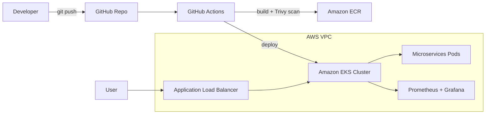

# Cloud-Native Microservices Deployment on Kubernetes (AWS EKS) with DevSecOps


A production-style deployment of a microservices application on **Amazon EKS**, with infrastructure provisioned using **Terraform**, automated **CI/CD with security scanning**, **autoscaling**, and **monitoring with Prometheus and Grafana**.


---

## 📌 Overview

This project demonstrates the complete DevOps lifecycle for a cloud-native application:

- **Provision** AWS infrastructure as code (VPC, private subnets, EKS, ECR, IAM)
- **Containerize** each microservice with Docker
- **Deploy** to Kubernetes using manifests/Helm with health probes, resource limits, and autoscaling
- **Automate** build, scan, push, and deploy with GitHub Actions
- **Secure** the pipeline and cluster (image scanning, RBAC, network policies, least-privilege IAM)
- **Monitor** cluster and application health with Prometheus and Grafana

## 🏗️ Architecture



*Replace or add a detailed diagram:* ``

**Flow:** A push to `main` triggers the pipeline, which builds Docker images, scans them with Trivy, pushes them to ECR, and deploys the updated release to EKS. Traffic reaches the services through an Application Load Balancer and an Ingress. Prometheus scrapes metrics and Grafana displays them.

## 🛠️ Tech Stack

| Category | Tools |
|---|---|
| Cloud | AWS (EKS, VPC, IAM, ECR, ALB) |
| Infrastructure as Code | Terraform |
| Containers | Docker, Kubernetes, Helm |
| CI/CD | GitHub Actions |
| GitOps *(if implemented)* | Argo CD |
| Security | Trivy, SonarQube/SonarCloud, RBAC, Network Policies, IRSA, Kubernetes Secrets |
| Monitoring | Prometheus, Grafana |

## ✨ Key Features

- **Infrastructure as Code:** VPC, private subnets, EKS cluster, and ECR created with Terraform and a remote state backend
- **CI/CD pipeline:** build → test → scan → push → deploy on every push
- **Shift-left security:** Trivy scans images and dependencies and fails the build on HIGH/CRITICAL findings
- **High availability:** multiple replicas, readiness/liveness probes, and rolling updates for zero-downtime releases
- **Autoscaling:** Horizontal Pod Autoscaler (HPA) scales pods based on CPU usage
- **Least privilege:** Kubernetes RBAC, namespaces, network policies, and IAM Roles for Service Accounts (IRSA)
- **Observability:** Grafana dashboards and alerts for CPU, memory, and pod restarts

*(Delete any feature you did not actually implement.)*

## 📂 Repository Structure

```
.
├── app/                    # Microservices source code and Dockerfiles
├── terraform/              # VPC, EKS, ECR, IAM (Infrastructure as Code)
├── k8s/                    # Kubernetes manifests (or helm/ for Helm charts)
│   ├── backend/
│   ├── frontend/
│   ├── ingress/
│   ├── hpa/
│   └── network-policies/
├── monitoring/             # Prometheus and Grafana configuration
├── .github/workflows/      # GitHub Actions CI/CD pipelines
├── docs/                   # Architecture diagram, screenshots, notes
├── .gitignore
└── README.md
```

## ✅ Prerequisites

- AWS account and an IAM user/role with required permissions
- Installed: AWS CLI, Terraform, kubectl, Helm, Docker, Git
- GitHub repository secrets configured (see [CI/CD](#-cicd-pipeline))

## 🚀 Getting Started

### 1. Clone the repository
```bash
git clone https://github.com/deepakbadnaware/k8s-microservices-eks-devops.git
cd k8s-microservices-eks-devops
```

### 2. Provision the infrastructure
```bash
cd terraform
terraform init
terraform plan
terraform apply
```

### 3. Connect kubectl to the cluster
```bash
aws eks update-kubeconfig --region <region> --name <cluster-name>
kubectl get nodes
```

### 4. Deploy the application
```bash
kubectl apply -f k8s/
# or with Helm
helm install <release-name> ./helm/<chart-name> -n <namespace>
```

### 5. Verify
```bash
kubectl get pods -n <namespace>
kubectl get svc,ingress -n <namespace>
```

### 6. Install monitoring
```bash
helm repo add prometheus-community https://prometheus-community.github.io/helm-charts
helm install monitoring prometheus-community/kube-prometheus-stack -n monitoring --create-namespace
```

## 🔄 CI/CD Pipeline

Defined in `.github/workflows/`. On every push to `main`:

1. **Checkout** code
2. **Build** Docker images
3. **Scan** with Trivy (and SonarQube/SonarCloud for code quality)
4. **Push** images to Amazon ECR
5. **Deploy** to EKS using kubectl/Helm

**Required GitHub secrets:** `AWS_ACCESS_KEY_ID`, `AWS_SECRET_ACCESS_KEY` *(or use GitHub OIDC with an IAM role, which is more secure)*, `AWS_REGION`, `ECR_REPOSITORY`, `EKS_CLUSTER_NAME`

## 🔒 Security Practices

- No credentials, `.pem` files, or `.tfstate` files in the repository
- Container images scanned with Trivy before deployment
- Pods run in dedicated namespaces with RBAC roles
- Network policies allow only required traffic between services
- IAM roles follow least privilege (IRSA for pods)
- Worker nodes run in private subnets

*(Only list what you really implemented.)*

## 📊 Monitoring and Alerting

- **Prometheus** collects cluster and application metrics
- **Grafana** dashboards show CPU, memory, pod status, and restarts
- **Alerts** trigger on high CPU usage and pod restarts

Access Grafana locally:
```bash
kubectl port-forward svc/monitoring-grafana 3000:80 -n monitoring
```

## 📸 Screenshots

| | |
|---|---|
|  |  |
| GitHub Actions pipeline run | Grafana dashboard |
|  |  |
| Running pods on EKS | Application running |

*(Hide AWS account IDs, endpoints, and any secrets before uploading screenshots.)*

## 🧩 Challenges and Solutions

| Problem | Cause | Solution |
|---|---|---|
| Pods stuck in `ImagePullBackOff` | Node role lacked ECR pull permission | Attached the ECR read policy to the node IAM role |
| Pods stuck in `Pending` | Insufficient node capacity | Adjusted resource requests and node group size |
| *(add your own real issues)* | | |

## 📚 What I Learned

- Provisioning and managing EKS clusters with Terraform
- Designing secure CI/CD pipelines with vulnerability scanning
- Kubernetes autoscaling, probes, rolling updates, and rollbacks
- Debugging with `kubectl logs`, `describe`, and Grafana metrics
- Applying least-privilege principles with IAM and RBAC

## 💰 Cost and Cleanup

EKS costs about $0.10/hour for the control plane, plus worker node costs. Destroy everything when finished:

```bash
kubectl delete -f k8s/
cd terraform && terraform destroy
```

## 🔮 Future Improvements

- GitOps with Argo CD
- Secrets management with AWS Secrets Manager and External Secrets Operator
- HTTPS with cert-manager or ACM
- Centralized logging with the EFK/Loki stack
- Cluster autoscaling with Karpenter

## 👤 Author

**Deepak Badnaware**
DevOps and Cloud Engineer | AWS, Kubernetes, Terraform, CI/CD

[LinkedIn](https://www.linkedin.com/in/deepakbadnaware) | [GitHub](https://github.com/deepakbadnaware) 

---

⭐ If you found this project useful, consider giving it a star.